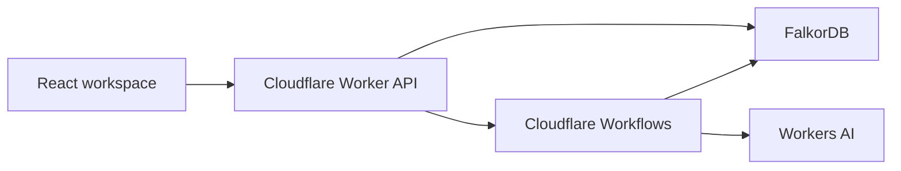

# UndoGraph product and technical specification

Status: proposed architecture and preparation notes, ready for review. The user approved the agent-repair direction and requested a professional working demo deployed on Cloudflare. Implementation begins during the hackathon window.

## Outcome and scope

An operator corrects a mistaken source, sees the stored work that read it directly or indirectly, and repairs affected pending artifacts across agent sessions. Unrelated work keeps its existing artifact IDs and content hashes. The graph captures supplied input dependencies; it does not establish that every supplied input causally influenced every sentence.

The first user is a team developing persistent customer-support agents. The first release demonstrates one bounded support scenario, not a general autonomous memory-security platform. Source corrections are explicit operator actions. Automatic poisoning detection, arbitrary agent instrumentation, email delivery, payments, document uploads, organization accounts, and vector retrieval are outside this release.

## Demonstration scenario

Use a fictional store named Northstar Goods and entirely synthetic sources and tickets:

- Return policy v1 incorrectly says returns are accepted within 30 days of delivery.
- Ticket R-021 is a change-of-mind return 21 days after delivery.
- Ticket R-007 is a change-of-mind return 7 days after delivery.
- Ticket A-001 asks for password-reset instructions.
- A separate account-help source explains the password-reset procedure.

The operator launches a build that creates two distinct persisted work sessions. The policy analyst extracts supported policy facts. A deterministic eligibility function evaluates each return ticket. The reply agent drafts responses from the recorded assessment and source evidence. Account help produces its own reply from the separate source.

Correct the erroneous policy to 14 days, keeping the correction explicit rather than implying that a legitimate new policy retroactively invalidates historical actions. The graph marks five derived artifacts stale: one policy-facts artifact, two assessments, and two return replies. The account-help reply is unaffected. R-021 changes from eligible to ineligible. R-007 remains eligible but is rebuilt because its recorded input changed. This makes the conservative nature of dependency tracking visible.

The five-artifact count assumes the initial build completed successfully; counters always come from the actual graph. Closing and reopening the browser recovers the same workspace and artifact history. A new work session is different from a new authenticated visitor session.

## Technology decisions

| Area | Choice | Purpose |
| --- | --- | --- |
| Language | TypeScript, strict mode | Shared contracts between browser and Worker |
| Local tooling | Node.js 24 LTS and npm | One package and committed lockfile |
| Browser | React with Vite | Responsive interactive operations workspace |
| Hosting and API | Cloudflare Workers with static assets and Hono | Same-origin frontend and bounded API routes |
| Development | Official Cloudflare Vite plugin and Wrangler | Exercise workerd rather than a Node-only development server |
| Durable execution | Cloudflare Workflows | Build and repair continue after a browser closes |
| Inference | Workers AI, `@cf/meta/llama-3.3-70b-instruct-fp8-fast` | Policy interpretation and reply drafting |
| Graph | External FalkorDB, official `falkordb` TypeScript client | Canonical artifacts, dependencies, runs and revisions |
| Validation | Zod | Validate request and model output schemas |
| Lineage view | React Flow and Dagre | Accessible node selection and left-to-right DAG layout |
| Styling | CSS variables and ordinary CSS; Lucide icons | Small coherent visual system |
| Verification | Vitest, Cloudflare's Workers test tooling, Playwright | Domain tests, actual runtime tests and browser acceptance |

Pin dependency versions in `package-lock.json` when implementation starts; use documented stable releases compatible with the Cloudflare plugin. Set Worker compatibility date to `2026-10-15` and explicitly retain `nodejs_compat`. This is a Workers deployment in the user's Cloudflare account; the Sites plugin hosting runtime is not the deployment target.

Cloudflare documents React plus Workers, outbound Node TCP/TLS APIs, durable steps, and the selected model. The FalkorDB client delegates socket configuration to node-redis. These documents support the architecture but do not establish end-to-end client compatibility. [React on Workers](https://developers.cloudflare.com/workers/framework-guides/web-apps/react/), [Node TCP](https://developers.cloudflare.com/workers/runtime-apis/nodejs/net/), [Node TLS](https://developers.cloudflare.com/workers/runtime-apis/nodejs/tls/), [Workflows API](https://developers.cloudflare.com/workflows/build/workers-api/), [Workers AI model](https://developers.cloudflare.com/workers-ai/models/llama-3.3-70b-instruct-fp8-fast/), [FalkorDB client](https://github.com/FalkorDB/falkordb-ts)

### First milestone and deployment gate

Before building the product UI, verify the official client inside workerd and a deployed Cloudflare preview. Authenticate to the chosen external FalkorDB endpoint, execute a parameterized write and read in an isolated disposable graph, return a multi-hop path, close the connection, and delete that exact disposable graph. Repeat a graph operation from a Workflow step. Prove certificate validation and refusal of incorrect database credentials.

Require a TLS-enabled graph endpoint for the publicly deployed service. FalkorDB's published free plan excludes TLS; access to a suitable managed endpoint or a self-hosted TLS endpoint is a deployment prerequisite. Do not provision paid services without an agreed budget. [FalkorDB plan comparison](https://www.falkordb.com/plans/)

If the official client fails the actual runtime probe, stop extending that integration and record the concrete incompatibility. The fallback is a small authenticated HTTPS gateway using the official client in a supported Node runtime. It accepts named application operations and validated arguments, never arbitrary Cypher or graph names from the browser. Keep the frontend, orchestration, and inference on Cloudflare. Select and verify gateway hosting before adopting this fallback; it is not assumed deployed or available. Do not implement a Redis wire protocol client as a hackathon detour.

## Architecture and execution

FalkorDB owns sources, artifacts, lineage, visitor ownership, current-version pointers, repair reports and run state. Workflows owns execution checkpoints and step retry state. The browser polls run progress every two seconds while a run is active, stops while hidden, and refreshes on focus. No D1, KV, R2, queues, embeddings, framework-managed memory or orchestration framework is needed initially.

Create and close the graph connection inside each request or Workflow step. Do not keep sockets in module globals or carry sockets across steps. Use a five-second connection timeout, bounded query timeouts and sanitized errors. Database outages return 503 and disable mutation controls; they do not switch to in-memory application storage.

Build and repair APIs return 202 with a run ID. The UI recovers progress from FalkorDB after navigation or reload. Use stable Workflow IDs and stable candidate artifact IDs to make retried persistence idempotent. A repair creates candidate artifacts first and promotes the replacement set only after every stage succeeds and the workspace revision still matches. A failed repair keeps old work stale and retains inspectable run evidence.

## Graph model and shared contracts

Use a separate graph per visitor workspace, with server-derived graph names. Common node labels:

- `Workspace`: `id`, `revision`, `createdAt`, `expiresAt`.
- `Artifact`: immutable `id`, `logicalId`, `version`, `kind`, `bodyJson`, `contentHash`, `createdAt`; mutable `status`, `isCurrent` and `needsReview` are lifecycle metadata. A released artifact may retain `isCurrent` until an explicit operator revision replaces it.
- `Session`: a persisted agent work session with `id`, `createdAt`.
- `Agent`: `id` and role `policy-analyst` or `reply-agent`.
- `Run`: `id`, `type`, `status`, `baseRevision`, `requestHash`, `createdAt`, `completedAt`, `errorCode`, `modelCalls`.
- `Step`: `id`, `stage`, `status`, `attempts`, `startedAt`, `completedAt`, optional provider usage.
- `Change`: `id`, old and new source IDs, operator reason and timestamp.
- `RepairReport`: repaired logical IDs, preserved artifact IDs and hashes, revision and run ID.

Artifact kinds are `source`, `case`, `policy-facts`, `assessment`, `reply`. Artifact statuses are `candidate`, `current`, `stale`, `superseded`, `released`. Run statuses are `queued`, `running`, `succeeded`, `failed`, `obsolete`.

Relationships:

- `(output:Artifact)-[:DEPENDS_ON]->(input:Artifact)` records the exact versions supplied to a computation.
- `(replacement:Artifact)-[:SUPERSEDES]->(previous:Artifact)` retains history.
- `(run:Run)-[:IN_SESSION]->(session:Session)` and `EXECUTED_BY` links identify agent work.
- `(run:Run)-[:HAS_STEP]->(step:Step)`; steps have `READ` and `PRODUCED` links to artifacts.
- `(change:Change)-[:REPLACES]->(oldSource:Artifact)` and `INTRODUCES` links describe corrections.

Create unique ID constraints for each label and indexes needed for logical IDs, current artifacts and run lookups. Wait for required constraints to become operational before readiness succeeds. All queries are named, parameterized application queries. Clients never select their own graph or submit Cypher.

The impact query follows reverse `DEPENDS_ON` paths from the old source. Supported workspace size is at most 250 artifact versions and dependency depth at most 12. Validate depth and acyclicity before writing a new artifact. Detect cycles or depth overflow in imported/corrupt state and report an incomplete audit; do not silently truncate and claim complete coverage. Deduplicate descendants while retaining explanation paths for fan-in graphs.

Shared TypeScript contracts include:

- `Artifact`, `Session`, `Run`, `Step`, `Change`, `WorkspaceSnapshot`, `ImpactReport`, `RepairPlan`, `RepairReport`.
- `PolicyFacts`: a discriminated union. The `supported` variant contains integer `returnWindowDays`, `sourceArtifactId`, `evidenceQuote`, `evidenceStart` and `evidenceEnd`. The `needs-review` variant contains `sourceArtifactId` and `reason`, with no asserted window. Eligibility must branch on this status before reading a window.
- `ReturnCase`: `id`, `daysSinceDelivery`, `reason`; eligibility is `eligible`, `ineligible` or `needs-review`.
- `Assessment`: `caseArtifactId`, `factsArtifactId`, `decision`, `explanation`.
- `ReplyDraft`: `assessmentArtifactId` or account-help source ID, `text`, `citations`, `reviewRequired`.
- `RunRequest`: `kind`, `expectedRevision`, optional `sourceArtifactId`.
- API errors: `{ error: { code, message, requestId } }`.

Hash canonical JSON with Web Crypto SHA-256. Dependency hashes contain ordered input version IDs, stage name and prompt version. Hashes identify reusable work and are not scientific or cryptographic proofs of model truth.

## Correction, repair and publication rules

Source correction is one guarded graph mutation: verify the expected workspace revision, create the new immutable source version and Change, supersede the old source, mark pending current descendants stale, flag affected released records for review without changing their released status, and increment the revision. A competing correction with the old revision receives 409. Real graph tests must establish the single-query behavior before relying on it; separate application read/write sequences are not sufficient.

A repair plan reads the graph, validates the DAG, replaces references to corrected sources and orders affected work with a deterministic topological sort. Reuse unrelated current input versions. Every repair-stage publication verifies the recorded revision and input versions. Final promotion checks the entire candidate set in one guarded mutation, updates current-version pointers, marks replaced versions superseded, and stores a report. A newer correction makes an old repair obsolete. Repeating a successful request returns its existing run/report.

The release control only marks a draft reviewed within this synthetic application; it sends nothing externally. Release must recheck freshness and revision in a guarded server-side graph mutation. A stale reply, or a reply with a stale ancestor, is rejected with 409. Previously released replies remain immutable historical records; affected historical work is listed for review rather than replayed as an external action.

## Agent behavior and limits

The policy analyst receives only recorded source artifacts and returns structured policy facts plus an exact source quotation. Verify quote offsets and the relevant numerical statement against the source. Unsupported or ambiguous extraction becomes `needs-review`, not a guessed window. The deterministic eligibility function owns the approve/deny rule.

The reply agent receives the persisted assessment, ticket and supporting evidence through the recorded-read helper. Validate structured output, decision consistency, and citation membership. Mark replies as requiring operator review because these checks cannot prove every free-text statement correct. Retrieved content is data and cannot grant tool permissions or expand allowed operations.

Default generation: temperature 0, maximum 600 output tokens per call, one structured-output correction attempt. Workflow model steps allow at most one transient retry with a three-second delay and a sixty-second attempt timeout. Validation and authorization failures are non-retryable. No nested autonomous agent loops.

Live mode calls Workers AI. Recorded walkthrough mode uses labeled fixtures and exposes its origin in the UI, run records and export. Never silently replace live inference after a failure. Record attempt counts and provider usage where returned; show unavailable token measurements as unavailable, not zero. Retries can incur additional model calls even when persistence is idempotent.

## HTTP API and visitor isolation

| Method and route | Behavior |
| --- | --- |
| `GET /api/health` | Worker liveness without credentials |
| `GET /api/ready` | Graph connection and schema readiness; sanitized 503 on failure |
| `POST /api/workspace` | Create or recover the visitor's isolated synthetic workspace |
| `GET /api/workspace` | Snapshot of sources, cases, artifacts, sessions and active run |
| `POST /api/sessions` | Create a new work session in the same visitor workspace |
| `POST /api/runs` | Start bounded build or repair; requires Idempotency-Key and expected revision |
| `GET /api/runs/:id` | Persisted progress, steps and result for an owned run |
| `POST /api/sources/:id/corrections` | Correct the current synthetic policy window and return graph impact |
| `GET /api/artifacts/:id/impact` | Paths and derived artifacts connected to an owned version |
| `POST /api/artifacts/:id/release` | Mark a fresh draft reviewed; never send it |
| `GET /api/export` | JSON audit of versions, paths, changes, runs and measured results |
| `POST /api/workspace/reset` | Reset only this visitor's workspace after confirmation |

Visitor identity uses a server-signed opaque cookie, HttpOnly, Secure in deployment, SameSite=Lax and 24-hour lifetime. Graph names are derived from the verified session identity with a keyed HMAC. Reopening the browser preserves the cookie; another browser gets another graph. Check same-origin mutation requests and validate bodies of at most 16 KiB. Unknown/foreign artifact and run IDs return 404. React renders text without HTML injection.

Use a small application-owned FalkorDB control graph for atomic inference quotas and an expiring workspace registry. Initial limits: 24 inference attempts per visitor hour, 400 inference attempts globally per UTC day, and 100 newly allocated workspaces globally per UTC day. Reserve an attempt before calling the model; retry attempts count too. A scheduled cleanup removes only registry-confirmed, expired `undograph_` workspace graphs and their registry entries. Never delete arbitrary graph names supplied by visitors. Limits produce 429 with a helpful message and leave the read-only walkthrough available.

## Experience direction

Use a restrained operations console: a charcoal navigation rail, light neutral work surfaces, blue primary controls, amber stale-state labels and green completed-state labels. Pair IBM Plex Sans with JetBrains Mono for technical identifiers; self-host fonts with license files. Use a consistent four/eight-pixel spacing rhythm, compact data tables, readable body text, restrained borders and 150–200 ms state transitions. These are proposed direction notes; final screens are designed during the event.

Desktop workspace: navigation rail, central case/source workspace and an inspectable lineage panel. On narrower screens, stack panels and provide a path list equivalent to the graph. Main views: overview, sources, sessions, replies, repair history. One primary action per current step. Clicking an artifact exposes source quotes, versions, recorded inputs and before/after content. Counters reflect persisted data.

Provide a guided demo entry, visible synthetic-data disclosure, clear live/recorded mode, a run-progress timeline, retryable error states, and a recovery action. Preserve form edits on failed submission. Include visible keyboard focus, labeled inputs, status text beyond color, accessible graph-node selection, reduced-motion support, and working layouts at 375, 768, 1024 and 1440 pixels. No invented customer logos, performance claims or decorative statistics.

## Acceptance and deployment

The release requires the deployed runtime probe; real graph tests for impact, isolation, stale-release protection, correction races and idempotence; Workers AI structured-output validation; and browser tests of the complete live scenario after reload. Each repaired reply cites its new source path. The account-help artifact retains both its ID and hash. Actual observed results, commit identity and verification commands belong in the verification record.

Deploy to Cloudflare through Wrangler with an AI binding and build/repair Workflow bindings. Keep `FALKORDB_HOST`, `FALKORDB_PORT`, `FALKORDB_USERNAME`, `FALKORDB_PASSWORD` and `SESSION_SECRET` in server-side configuration/secrets. Use separate graph/control prefixes and Workflow names for local, preview and production environments. No secret may enter browser bundles or exports. Verify the live URL, deep links, API and database after deployment. Configure a custom domain only if the user supplies one; a working workers.dev URL is acceptable.

Prepare the public repository, setup instructions, graph diagram, central Cypher queries, AI-assistance disclosure, measured demo results, and a three-minute recording. Use only licensed assets and synthetic application data. [Hackathon submission requirements](https://www.wemakedevs.org/hackathons/falkordb/rules)

## Milestones

| Date in IST | Deliverable |
| --- | --- |
| October 14 | Review these preparation notes and plan; confirm deployment prerequisites |
| October 15 | Runtime connection proof, graph/domain layer and first complete live build |
| October 16 | Correction, repair, stale-release guard and persistence acceptance |
| October 17 | Professional UI, visitor isolation, preview deployment and browser QA |
| October 18 | Final cloud verification, demo recording and submission before 11:59 PM IST |

Execution defaults to implementing tasks in this session to limit context overhead. Independent agents are not required for the plan. A review of this written specification and implementation plan precedes product implementation.
