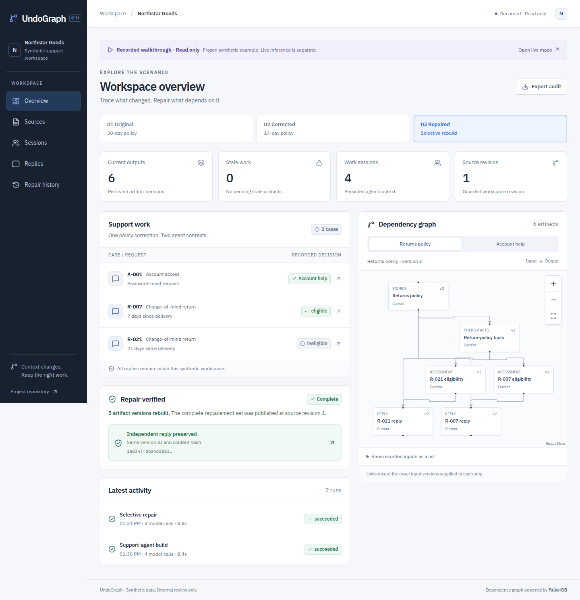
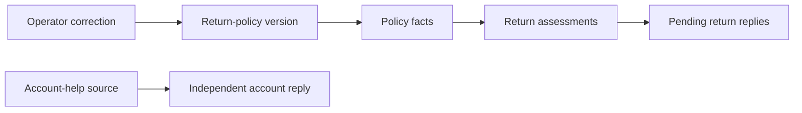

# UndoGraph

UndoGraph repairs an agent's stored context and pending work after an operator corrects a source. FalkorDB records the input dependencies that determine which artifacts become stale and which work must run again.

The demo is a fictional customer-support workspace. Correct a return window from 30 days to 14 days, inspect affected work from two agent sessions, regenerate pending replies, and verify that an unrelated password-reset reply retains its original version and content.

## Project documents

- [Product and technical specification](DESIGN.md)
- [Implementation plan](IMPLEMENTATION_PLAN.md)
- [Setup, checks and deployment](docs/DEPLOY.md)
- [Observed verification and measurements](docs/VERIFICATION.md)
- [Graph model and queries](docs/GRAPH.md)
- [Three-minute demo guide and AI-assistance disclosure](docs/DEMO.md)
- [Asset origins and licenses](docs/ASSETS.md)
- [Implementation decisions and review outcomes](docs/EXECUTION.md)

Target deployment: a React application and API on Cloudflare Workers, durable runs on Cloudflare Workflows, inference on Workers AI, and an external FalkorDB instance. FalkorDB remains the canonical application database.

## Current status

The local application is implemented: the operations workspace, immutable graph storage, durable agent builds, source correction, selective repair, stale-release guards, visitor isolation, quotas, reset, expiry cleanup and audit export. The complete local browser scenario has passed with real Workers AI, including exact preservation of independent work. Cloud deployment is pending a TLS-enabled database endpoint and deployed verification.

## Local development

Requires Node.js 24 and Docker with Compose. Run commands from this directory:

```sh
npm ci
npm run setup:local
npm run db:up
npm run dev
```

Open <http://127.0.0.1:5173>. Choose **Start live workspace** to create isolated synthetic inputs, then **Build agent work**. The Sources, Sessions, Replies and Repair history views expose the actual persisted records. [UI and browser verification](docs/UI.md) describes the complete flow.

The read-only recorded example is at <http://127.0.0.1:5173/#/recorded/overview>. To explore it without a Cloudflare connection, run `UNDOGRAPH_OFFLINE=1 npm run dev`. Recorded mode stays labeled and sends no mutation requests; it never substitutes for a failed live run.



The setup command creates ignored `.dev.vars` with fresh local secrets and preserves it on subsequent runs. FalkorDB is exposed only at `127.0.0.1:16379`; its named Docker volume persists data. `npm run db:stop` stops the container without deleting data.

Live runs use the remote Workers AI binding while the Worker, Workflows and database run locally. Authenticate Wrangler with `npx wrangler login` using your Cloudflare account. Inference attempts are bounded by visitor/hour and global/day quotas. A failed live run stays visibly failed; it never switches to recorded output. APIs support workspace recovery, build/repair runs, source corrections, artifact impact and internal draft review. Mutation requests require the app's exact Origin and a valid JSON body; runs also require an `Idempotency-Key`.

```sh
npm run typecheck
npm run lint
npm test
UNDOGRAPH_LIVE_AI=1 npm run test:e2e
npm run build
node scripts/cloud-smoke.mjs --base-url http://127.0.0.1:5173 --benchmark
```

The backend suite passes 111 tests against the real local database/runtime. All nine browser tests pass with live inference enabled. The offline CI path passes eight browser tests and explicitly skips the live-inference test. Full smoke testing creates isolated synthetic visitors and deletes their completed workspaces. Use `--probe` for health/readiness checks alone.

In one local comparison using the same corrected source/case content, selective repair used three model calls and 8.899 seconds; a fresh build used four calls and 9.458 seconds. The independent account reply kept its exact ID, hash and content. These are observed measurements, not a performance guarantee; [the verification record](docs/VERIFICATION.md) includes provider usage and an earlier repair that took longer.

`npm run probe:local` exercises the official database client inside workerd, including parameterized writes, a three-hop graph path, authentication refusal, connection cleanup, and a real local Workflow step. Graph tests use disposable, uniquely named graphs and report skips when database credentials are absent.

`GET /api/health` tests Worker liveness. `GET /api/ready` verifies operational application indexes and constraints, performs a real database query, and returns a sanitized 503 when unavailable. [Graph storage and query contracts](docs/GRAPH.md) describe versioning and audit limits.

## How repair works



Arrows show input-to-output flow. FalkorDB stores the reverse `DEPENDS_ON` edges on exact artifact versions. A correction invalidates graph descendants; repair stages replacements and publishes them together under a revision guard. Historical releases remain available for review.

The Graph Hacks event closes October 18, 2026 at 11:59 PM IST. Preparation documents and implementation have separate commits. See [official rules](https://www.wemakedevs.org/hackathons/falkordb/rules) and the [demo guide](docs/DEMO.md) before submission.

## Intended result

A publicly accessible Cloudflare demo with synthetic data, isolated visitor workspaces, actual recorded agent runs, inspectable dependency paths, recoverable failures, and a reproducible comparison before and after repair. Recorded examples may provide an explicitly labeled read-only walkthrough; they must never be presented as live inference.

Primary track: Agent Memory and Coordination. Secondary track: Agents That Act on Connected Data, provided the final implementation demonstrates graph-driven repair actions.
