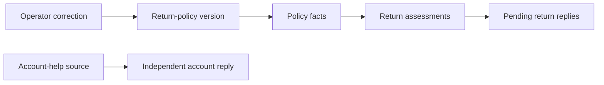

# UndoGraph

UndoGraph repairs an agent's stored context and pending work after an operator corrects a source. FalkorDB records the input dependencies that determine which artifacts become stale and which work must run again.

Create a workspace with your own document sources and questions. Build source notes and grounded answer drafts, correct a source, then inspect which dependent outputs are repaired and which keep their exact version and hash. Editable project-planning and research examples are included. The original fictional Northstar Goods return-policy workspace remains available as an example.

Public demo: [website](https://undograph-preview.the-workflow-worker.workers.dev), [live workspace](https://undograph-preview.the-workflow-worker.workers.dev/#/setup), [guided simulation](https://undograph-preview.the-workflow-worker.workers.dev/#/simulation/overview).

## Project documents

- [Product and technical specification](DESIGN.md)
- [Implementation plan](IMPLEMENTATION_PLAN.md)
- [Setup, checks and deployment](docs/DEPLOY.md)
- [Railway deployment and fallback simulation](docs/RAILWAY.md)
- [Observed verification and measurements](docs/VERIFICATION.md)
- [Graph model and queries](docs/GRAPH.md)
- [Three-minute demo guide and AI-assistance disclosure](docs/DEMO.md)
- [Asset origins and licenses](docs/ASSETS.md)
- [Implementation decisions and review outcomes](docs/EXECUTION.md)

Deployment: a React application and API on Cloudflare Workers, durable runs on Cloudflare Workflows, inference on Workers AI, and FalkorDB with an authenticated HTTPS gateway on Railway. FalkorDB remains the canonical application database.

## Current status

Custom workspaces are deployed on the public demo: 1–3 sources (up to 2,000 characters each) and 1–3 questions (up to 500 characters each), with explicit source selections. The [public verification](https://github.com/Tejas-Sands/undograph/actions/runs/39108021219) passed on October 18, 2026 with real Workers AI: both project and research browser walkthroughs completed build, source correction, stale-review refusal, repair, updated citations and exact independent preservation. The original Northstar live smoke also passed. The live entry always opens blank setup. Returning visitors can explicitly resume their saved workspace or confirm replacement.

The complete [runtime CI run](https://github.com/Tejas-Sands/undograph/actions/runs/39107536993) passed, including 63 unit cases, real FalkorDB repair, 29 offline browser cases and Railway container checks. Its three real-inference browser cases are explicitly skipped; the separate public verification above exercises the deployed provider. Update the gateway before the Worker, as described in [deployment](docs/DEPLOY.md).

The public preview passed the complete real-Workers-AI build/correction/repair smoke on October 17, 2026 (IST), including exact preservation, visitor isolation and audit export. Browser verification also completed a live build and recovered from a network failure into the labeled simulation while offline. The operator confirmed the Railway volume is mounted at `/data`; a forced restart of the public database was not part of this check. See [the verification record](docs/VERIFICATION.md) for evidence and limits.

## Local development

Requires Node.js 24 and Docker with Compose. Run commands from this directory:

```sh
npm ci
npm run setup:local
npm run db:up
npm run dev
```

Open <http://127.0.0.1:5173> for the landing page. Choose **Open workspace**, enter your details or load an editable project/research example, then choose **Create live workspace** and **Build agent work**. Use **Load support example** for the optional Northstar inputs. The Sources, Sessions, Replies and Repair history views expose the actual persisted records. [UI and browser verification](docs/UI.md) describes the complete flow.

The read-only recorded example is at <http://127.0.0.1:5173/#/recorded/overview>. To explore it without a Cloudflare connection, run `UNDOGRAPH_OFFLINE=1 npm run dev`. Recorded mode stays labeled and sends no mutation requests; it never substitutes for a failed live run.

Choose the small **Recorded demo** button at the bottom left for a guided five-step demonstration, or open <http://127.0.0.1:5173/#/simulation/overview>. It covers the shared sessions, 30→14-day correction, five stale outputs, blocked review, selective repair and preserved ID/hash. It uses bundled recorded evidence, works without the API and remains clearly labeled. Live errors offer an explicit simulation recovery link.


The setup command creates ignored `.dev.vars` with fresh local secrets and preserves it on subsequent runs. FalkorDB is exposed only at `127.0.0.1:16379`; its named Docker volume persists data. `npm run db:stop` stops the container without deleting data.

Live runs use the remote Workers AI binding while the Worker, Workflows and database run locally. Authenticate Wrangler with `npx wrangler login` using your Cloudflare account. Inference attempts are bounded by visitor/hour and global/day quotas. A failed live run stays visibly failed; it never switches to recorded output. APIs support workspace recovery, build/repair runs, source corrections, artifact impact and internal draft review. Mutation requests require the app's exact Origin and a valid JSON body; runs also require an `Idempotency-Key`.

```sh
npm run typecheck
npm run lint
npm test
UNDOGRAPH_LIVE_AI=1 npm run test:e2e
npm run build
node scripts/cloud-smoke.mjs --base-url http://127.0.0.1:5173 --benchmark
```

The suites cover the original retail scenario and custom project/research workspaces: input validation, exact quotations and citations, source-scoped dependency repair, preserved ID/hash pairs and revision conflicts. Gateway Workflow tests count actual HTTP/model requests for a maximum-size custom workspace, including corrected model output and a lost save acknowledgement, against Cloudflare Free's 50-request limit. Browser checks cover custom input, source correction, validation, mobile layout, recorded mode and the original retail flow. Regular CI explicitly skips real Workers AI; its Workflow tests use an explicitly test-only inference provider with real FalkorDB. The separate public verification workflow uses the deployed provider. Full smoke testing creates isolated synthetic visitors and deletes their completed workspaces. Use `--probe` for health/readiness checks alone.

In the verified public comparison using the same corrected source/case content, selective repair used three model calls and 12.955 seconds; a fresh build used four calls and 15.145 seconds. The independent account reply kept its exact ID, hash and content. These are observed measurements, not a performance guarantee; [the verification record](docs/VERIFICATION.md) includes provider usage and earlier local runs, including a repair that took longer.

`npm run probe:local` exercises the official database client inside workerd, including parameterized writes, a three-hop graph path, authentication refusal, connection cleanup, and a real local Workflow step. Graph tests use disposable, uniquely named graphs and report skips when database credentials are absent.

`GET /api/health` tests Worker liveness. `GET /api/ready` verifies operational application indexes and constraints, performs a real database query, and returns a sanitized 503 when unavailable. [Graph storage and query contracts](docs/GRAPH.md) describe versioning and audit limits.

## Custom workspaces

Enter a workspace name, source titles/text and questions. Select exactly which sources each question may use. A project release brief, research notes, an internal process or another text-based knowledge task can use the same flow; the engine has no customer-service requirement. It does not crawl URLs or ingest files.

Each source produces notes containing exact quotations with character offsets. Each answer records its question, all selected source versions and their notes as dependencies, with citations to supplied source versions. Those recorded inputs determine the repair scope even if an answer cites only one of its selected sources. Inspect any artifact to see its evidence and lineage. Generated answers are drafts; citation validation checks provenance and does not prove semantic accuracy.

After building, open **Sources**, choose **Correct source text**, replace the text and explain the change. Impact and stale-answer status come from persisted graph descendants. Choose **Repair affected work** to replace only those outputs. Keep at least one question on an independent source to inspect exact preservation. **New workspace** opens blank setup and requires explicit acknowledgement before replacing existing work. Reloading a workspace view restores the same workspace; reloading setup keeps the setup form open.

## How repair works



Arrows show input-to-output flow. FalkorDB stores the reverse `DEPENDS_ON` edges on exact artifact versions. A correction invalidates graph descendants; repair stages replacements and publishes them together under a revision guard. Historical releases remain available for review.

The Graph Hacks event closes October 18, 2026 at 11:59 PM IST. Preparation documents and implementation have separate commits. See [official rules](https://www.wemakedevs.org/hackathons/falkordb/rules) and the [demo guide](docs/DEMO.md) before submission.

## Intended result

A publicly accessible Cloudflare demo with synthetic data, isolated visitor workspaces, actual recorded agent runs, inspectable dependency paths, recoverable failures, and a reproducible comparison before and after repair. Recorded examples may provide an explicitly labeled read-only walkthrough; they must never be presented as live inference.

Primary track: Agent Memory and Coordination. Secondary track: Agents That Act on Connected Data, provided the final implementation demonstrates graph-driven repair actions.
