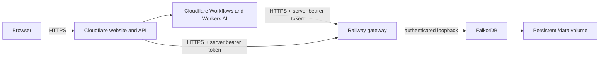

# Railway deployment

The repository contains a tested container for FalkorDB and an authenticated HTTP gateway. Cloudflare serves the website, API, Workers AI and durable Workflows. Railway provides the database service and public HTTPS termination. Deployment to a real Railway account still requires account access and a successful public smoke test.



The gateway accepts a fixed allowlist of named graph operations, parameters and environment-specific graph names. It never accepts arbitrary Cypher. Browser visitors cannot call it without the server secret. Visitor ownership and quotas stay in the Worker. The database binds only to `127.0.0.1` inside the container; do not add a public TCP proxy or expose port 6379. A Railway HTTP domain provides public TLS; a raw TCP proxy is not that TLS layer.

## 1. Create the Railway service

Sign in to Railway with GitHub and connect `Tejas-Sands/undograph`. Use the repository root and its `Dockerfile` / `railway.json`. This is a self-hosted FalkorDB instance; no separate FalkorDB Cloud account or AWS account is needed. An existing FalkorDB Cloud instance is a separate deployment option only when its connection is healthy and supports verified TLS.

Railway advertises a no-card trial with a one-time $5 credit lasting up to 30 days, then a Free plan with $1 monthly credit. GitHub verification determines full versus limited trial access; limited trials restrict outbound access. These are usage credits, not a promise of continuous free hosting. Check the dashboard’s actual allowance, memory, volume and remaining credit before deployment. No paid upgrade is part of this setup. [Pricing](https://railway.com/pricing), [trial and verification](https://docs.railway.com/pricing/free-trial).

Create credentials locally:

```sh
npm run setup:railway
```

This creates `.env.railway` with mode 0600 and preserves any existing file. It contains generated database, gateway and session secrets; no GitHub token is used or stored. Open it in your editor and copy only these variables to Railway’s service variables:

| Railway variable | Value |
| --- | --- |
| `FALKORDB_PASSWORD` | Generated value recommended; existing passwords also work (1–512 UTF-8 bytes, no control characters) |
| `GRAPH_GATEWAY_TOKEN` | Generated value; at least 32 characters |
| `GATEWAY_GRAPH_PREFIXES` | `undograph_preview_` |
| `PORT` | `8080` |

Set these on the **same Railway service that runs this repository**. A first deployment may start before the variables exist; add them and redeploy the latest commit. Enter password values directly, without surrounding shell quotes. `GRAPH_GATEWAY_TOKEN` is separate from the database password and must contain at least 32 characters.

This container starts its own FalkorDB on loopback and uses the built-in Redis user `default`. The name, instance ID, username and password shown in FalkorDB Cloud describe a different managed database; entering those details does not connect this container to that cloud instance. No remote cloud data is seeded by the gateway startup. UndoGraph creates its synthetic inputs only when a visitor chooses **Start live workspace**.

Attach a persistent volume mounted at **`/data`** before the first useful run. Keep one replica and disable service sleeping/serverless mode for the demonstration. The container uses append-only persistence with a one-second fsync interval; abrupt host failure can lose the latest second. The 256 MB Redis memory setting does not cap all graph-module or process memory. Use the account’s available memory, observe actual usage, and keep this a small synthetic demo. [Volumes](https://docs.railway.com/volumes/reference).

Deploy, then use **Settings → Networking → Generate Domain**, targeting port 8080. Expect `GET https://your-domain/health` to return `{"ready":true}` only when authenticated database queries succeed. The domain root returns 404 intentionally: this service is the private API gateway, not the website. Save the HTTPS origin without a path, query or trailing extra slash. [Public networking](https://docs.railway.com/networking/public-networking), [configuration reference](https://docs.railway.com/config-as-code/reference).

## 2. Connect Cloudflare preview

The Worker needs three server-side secrets. Enter them through Wrangler prompts so they do not appear in shell history:

```sh
npx wrangler secret put GRAPH_GATEWAY_URL --env preview
npx wrangler secret put GRAPH_GATEWAY_TOKEN --env preview
npx wrangler secret put SESSION_SECRET --env preview
npm run deploy:preview
```

Use the Railway **HTTPS origin**, the matching gateway token, and the generated session secret. Do not set `VITE_` credentials or publish `.env.railway`, `.dev.vars`, or `dist/gateway`. The gateway route takes precedence over direct database settings and fails closed if its configuration is incomplete. The browser receives only static assets and owned application records.

The preview Worker already uses `undograph_preview_` and distinct Workflow names. When ready to deploy production, add `undograph_production_` to the Railway prefix list (comma-separated), redeploy the gateway, set the same three production secret names with a **different session secret**, then run `npm run deploy:production`. A separate Railway service/volume is optional if stronger environment isolation is needed.

## 3. Verify the public application

Run against the Cloudflare website URL, not the Railway domain:

```sh
node scripts/cloud-smoke.mjs --base-url https://your-worker.workers.dev --benchmark
```

This performs real inference, reload recovery, correction, stale-review refusal, selective repair, preserved-ID/hash verification, visitor isolation and export. It consumes bounded AI/database quota. Record results in `docs/VERIFICATION.md`; a healthy gateway alone does not prove the whole deployed flow works.

Then open `/#/simulation/overview`. Walk through all five steps, inspect the two return decisions and preserved evidence, and export the audit. Simulation is explicitly labeled, uses bundled recorded synthetic evidence and makes no API calls. A small bottom-left button opens it from the website; live errors offer **Continue in simulation**. Live failures remain visible until that choice. After the initial page assets load, the simulation also works if the network drops; a cold offline visit still needs a previously available page.

## Reproduce the container checks locally

```sh
docker build -t undograph-railway:test .
npm run test:railway
UNDOGRAPH_RAILWAY_PASSWORD_CASE=short npm run test:railway
UNDOGRAPH_RAILWAY_PASSWORD_CASE=quoted npm run test:railway
npm run test:gateway
npm run test:gateway:worker
```

The container smoke allocates its own random secrets, container and disposable volume, checks authorization and persistence, restarts it, verifies graceful shutdown, kills its database child and verifies the whole service exits unsuccessfully. It removes only those test resources. The Worker suite exercises all graph/API/Workflow cases through the actual HTTP adapter against a local database.

## Recovery and rollback

If health remains 503, check Railway’s deployment logs, credential variable presence, volume mount/write access and memory/credit limits. Wrong/missing secrets, foreign prefixes, full storage or a stopped database must fail visibly. If FalkorDB Cloud reports an unhealthy node, check its exact connection port and provider status; do not infer a healthy connection from DNS alone.

For a gateway regression, redeploy the previous known-good Git commit while retaining the same volume and compatible graph contracts. Keep credential rotation coordinated with both Cloudflare environments. A Worker rollback does not roll back database history. Preserve a demo recording and the simulation URL before the event; the simulation keeps its recorded label even if live infrastructure fails.
